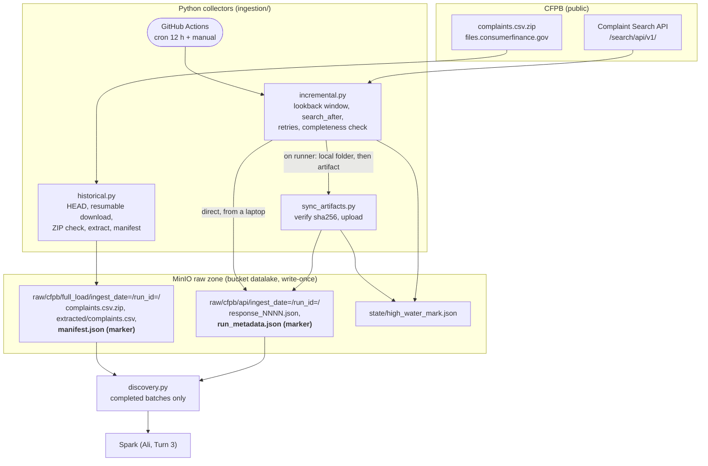

# Turn 2 report: CFPB data acquisition and raw data layer

Author: Maroun Machaalany. Course 020IABDM2 Big Data Frameworks, USJ / ESIB (Dr. Yehia Taher).
Branch: `feat/turn2-acquisition-raw-layer`. Date of writing: 2026-11-14.

> **Read this first: what is and is not verified (updated 2026-11-19).** The code was first built
> and tested in a sandbox without access to CFPB, Docker or MinIO (212 tests, then 213 after a
> pagination fix; a 343 MB / 3,000,000-row load at 42 MB peak memory). On 2026-11-19 the author then
> ran it on a laptop against the **real CFPB file and a real MinIO container** (section 8.4): the
> historical load succeeded (19,281,923 records), the rerun was skipped, discovery lists the batch
> as complete, and the 3 MinIO integration tests pass. **Still not verified live:** the incremental
> collector against the real API (needs the team's product label), the GitHub Actions schedule and
> the artifact sync.

---

## 1. Introduction

The platform collects public CFPB consumer-complaint data, cleans it with Spark, serves it from
MongoDB and shows it in Streamlit. My Turn 2 delivers the **first two boxes**: getting the data
reliably out of CFPB and into the **raw zone** of MinIO, exactly as it was published, with enough
metadata that every later layer can trust it and trace it.

Two sources, two collectors:

* **Historical**: one big CSV in a ZIP (about 19 million complaints). Loaded once, repeatable.
* **Incremental**: the CFPB search API, called every 12 hours for recent complaints.

The design goals, in order: never lose data, never silently change data, survive a bad network, use
little memory, be safe to rerun, and let the next person (Ali, Spark) find *finished* data without
guessing.

## 2. Responsibilities

Assigned to me (README team table, `CONTRIBUTING.md`): **Turn 2** (acquisition and raw layer) and
Turn 5 (analysis). The Turn 2 issues, recovered from `scripts/github/bootstrap_project.ps1`, and
where each is handled:

| Turn 2 issue | Delivered in |
|---|---|
| Historical loader: download the full CSV ZIP into MinIO with a manifest | `ingestion/historical.py`, `ingestion/download.py` |
| Risk: full CSV download on a slow connection | resumable download, `--inspect`, `--dry-run` (the measurement itself is yours to run, section 8.3) |
| Incremental API collector: window, overlap, `search_after`, retries, run metadata | `ingestion/incremental.py` |
| Scheduled collection on GitHub Actions every 12 h, with manual trigger | `.github/workflows/incremental-collection.yml` |
| Sync collected runs from GitHub artifacts into the MinIO raw zone | `ingestion/sync_artifacts.py` |
| Development sample and sampling script | `scripts/make_sample.py`, `data/sample/` |
| Collector tests with a mock API | `tests/unit/test_incremental.py` and four more test files |
| Verify CSV header and API date formats; update the data dictionary | checked against the OpenAPI spec; live confirmation pending (section 8.3) |

**Not done on purpose (scope):** Turn 5 analysis, Spark cleaning, MongoDB, the dashboard. No file in
`processing/`, `database/`, `analytics/`, `dashboard/` or `common/` was changed.

**Source of requirements.** I could not read the live GitHub issue pages (rate limited, and the
GitHub API was not linked to the session). The issue text above comes from the bootstrap script in
the repository, which is what created the issues. If someone edited an issue afterwards, compare.

## 3. Architecture



Why two routes for the incremental data: the GitHub runner has no access to our MinIO. The workflow
collects into a local folder with the **same key layout** and keeps it as an artifact;
`sync_artifacts` later uploads it unchanged. From a laptop, the collector can write to MinIO directly.

## 4. Implementation details

Shared conventions: standard library plus `requests`, `PyYAML`, `jsonschema` and `minio` (all already
pinned in `requirements.txt`, except `jsonschema` which I added). Settings come from
`config/settings.yaml`; credentials only from environment variables (`MINIO_*`) via
`common.config.env`. Nothing is hard-coded to a domain.

### 4.1 `ingestion/layout.py` - the one place object keys are built

* **Purpose:** produce every key and run id exactly as `docs/data_contracts.md` defines them.
* `new_run_id(source, now, rand)` -> `full_20261113T090000Z_9f8e7d` (UTC time + 6 random hex).
  Raises `ValueError` for an unknown source.
* `Layout` (frozen dataclass): `from_settings()` reads `storage.*` prefixes; methods `archive_key`,
  `extracted_key`, `manifest_key`, `page_key` (`response_0001.json`), `run_metadata_key`,
  `state_key`. Page numbers below 1 raise `ValueError`.
* `parse_run_prefix(key)` extracts `(ingest_date, run_id)`; used by discovery and sync.
* **Tests:** keys are matched against the regex patterns inside the project's own JSON schemas.

### 4.2 `ingestion/storage.py` - raw-zone storage

* **Purpose:** one small interface (`RawStore`) with two backends, so the same collector code runs
  against MinIO, a local folder (GitHub runner, dry runs) or tests.
* `MinioStore(client, bucket)`: `from_env()` builds the `minio` client from `MINIO_ENDPOINT`,
  `MINIO_ROOT_USER`, `MINIO_ROOT_PASSWORD`, `MINIO_BUCKET` (reusing `parse_endpoint` from
  `scripts/init_storage.py`). Files go up with `fput_object` in 64 MiB parts (never loaded into RAM).
  After every upload it calls `stat_object` and checks the size.
* `LocalStore(root)`: same API on a folder. Writes go to a temp file and are renamed, so a crash never
  leaves a half-written object.
* **Write-once rule:** `put_bytes`/`put_file` raise `ObjectExistsError` if the key exists, unless
  `overwrite=True` (only `state/high_water_mark.json` uses it).
* `validate_key` rejects `..`, absolute paths, `//`, backslashes.
* **Error handling:** every backend failure becomes `StorageError` with the key in the message.

### 4.3 `ingestion/net.py` - HTTP with retries

* `RetryPolicy(timeout_seconds, max_retries, backoff_base_seconds)`; `delay(n) = base * 2^(n-1)`,
  capped at 60 s.
* `HttpClient.request(method, url, params, headers, stream)`:
  * retries timeouts, connection errors, HTTP 429/500/502/503/504, honouring `Retry-After`;
  * **fails fast** on other 4xx (`HttpStatusError`, e.g. 404);
  * never loops forever: after `max_retries` it raises `RetriesExhausted`;
  * counts `retry_count` and remembers `last_status` (both go into the metadata).
* The timeout default is 60 s because the Turn 1 probe measured 21 s for 5 records.

### 4.4 `ingestion/download.py` - streaming, resumable download

* `head_source(client, url)` -> size, ETag, Last-Modified, Accept-Ranges (HTTP HEAD).
* `download_resumable(client, url, dest, chunk_bytes)`:
  * streams to `dest.part` in 1 MiB chunks (constant memory);
  * if the connection breaks, it asks for the rest with `Range: bytes=<offset>-` and
    `If-Range: <ETag>`, so if the server's file changed it sends the new file whole and we never mix
    two versions;
  * a `.part.json` sidecar remembers which URL the partial bytes belong to;
  * done only when bytes received equal the announced size; then computes SHA-256 from disk;
  * budget: `max_retries` interruptions, then `DownloadError`; the `.part` is **kept** so the next run
    resumes instead of restarting.

### 4.5 `ingestion/contracts.py` - contract validation

`validate_manifest` and `validate_run_metadata` check a document against
`config/schemas/*.schema.json`. A document that fails is **never written** as a completion marker.

### 4.6 `ingestion/historical.py` - the historical loader

* **Inputs:** `source.full_csv_url`, `historical.*` settings, a `RawStore`. **Outputs:** three objects
  in MinIO (ZIP, extracted CSV, `manifest.json`) and a `LoadResult`.
* `validate_archive`: must be a valid ZIP with exactly one member, `complaints.csv`, non-empty.
* `extract_member`: streams the member to disk while hashing; Python's `zipfile` verifies the CRC-32
  at the end, so a corrupted archive raises instead of producing a silently wrong CSV.
* `read_csv_structure`: header and row count using the `csv` module (not a line count, because quoted
  fields can contain newlines). Requires `Complaint ID` and `Date received`; rejects an empty file.
  This is a *structure* check only: no cleaning, that is Spark's job.
* `same_source_version`: ETag equal, or Last-Modified plus size equal, against the newest completed
  manifest.
* `HistoricalLoader.run(force, dry_run, keep_temp)` -> see section 5.
* `inspect_source`: HEAD plus a `Range` request for the first 256 KB; `parse_zip_prefix` decodes the
  ZIP local header and inflates the first bytes, giving the **real CSV header, date samples and ZIP
  size without downloading the file**.
* **Errors:** everything becomes `HistoricalError` (exit code 1); config/storage problems exit 2.

### 4.7 `ingestion/incremental.py` - the incremental collector

* `IncrementalSettings`: validates `page_size` 1..100 (API limit) and `lookback_days >= 0`.
* `HighWaterMark(date_received, complaint_id)` and `HighWaterMarkStore`: read/advance
  `state/high_water_mark.json`. `advance` only moves **forward**. A corrupt file raises an error
  instead of silently resetting.
* `compute_window(previous, today, lookback, date_min, date_max)` -> `[HWM - lookback, today]`;
  explicit dates override; no state gives `today - lookback`; a checkpoint in the future is clamped
  (found by a test) so it cannot empty the window.
* `build_params` -> repeated `product` parameters, `date_received_max + 1 day` (exclusive upper bound
  per the spec), `size`, `sort`, `no_aggs`, `no_highlight`, optional `search_after`.
* `parse_page` validates the structure (`hits.hits[]._source` with a `complaint_id`) and reads
  `hits.total` (value and `eq`/`gte`). Anything else raises `InvalidResponse`.
* `next_cursor`: `_meta.break_points[<next page>]` if present, else the last hit's `sort` values joined
  with `_`. If neither exists, the run **stops loudly**.
* `IncrementalCollector.run(...)`: see section 6.
* Exit codes: 0 success or dry run, 1 failed, 2 configuration, 3 partial.

### 4.8 `ingestion/discovery.py` - completed batches

`discover(store, layout, kind)` groups objects by run, applies the completion rule (section 7.3) and
returns `RawRun` records with `complete`, `reason`, `data_keys`, `record_count`.
`completed()` keeps only complete ones. CLI: `python -m ingestion.discovery [--json] [--incomplete]`.

### 4.9 `ingestion/sync_artifacts.py` - GitHub artifacts into MinIO

`sync_run` validates the metadata, checks that the artifact path matches the run id, verifies **every
page's size and SHA-256**, skips runs already in MinIO, uploads pages first and `run_metadata.json`
last, and advances the high-water mark only for `success` runs. `GitHubArtifacts` lists/downloads
artifacts with `GITHUB_TOKEN` (never logged). `safe_extract` blocks zip-slip paths. `--from-dir`
syncs an already-downloaded folder with no token.

### 4.10 Other files

* `ingestion/version.py`: `code_version` from env or by reading `.git` directly (no `git` binary in the
  slim image).
* `scripts/make_sample.py`: synthetic, deterministic sample (missing state, invalid date, duplicate
  `complaint_id`, newline in a quoted field); `--from-zip` samples real rows by streaming.
* `.github/workflows/incremental-collection.yml`, `requirements-collector.txt`: the scheduled job.
* `docker-compose.yml`: new on-demand `ingestion` service (profile `tools`).

## 5. Historical collector, step by step

1. **HEAD** the URL: size, ETag, Last-Modified. A failed HEAD is tolerated; the download then reports
   the real error.
2. **Skip check.** Find the newest *completed* load. If its manifest recorded the same ETag (or the
   same Last-Modified and size), stop: `skipped_up_to_date`. No download, no upload. `--force`
   overrides.
3. `--dry-run` stops here and prints the plan.
4. Create `run_id` and `ingest_date` (UTC). Check free disk space for the ZIP.
5. **Download** (section 4.4). Scratch folder: `data/tmp` (git-ignored, bind-mounted in Docker, so a
   partial download survives between runs).
6. **Identical-content check:** if the SHA-256 equals the newest manifest's, drop the download and
   store nothing (`skipped_identical`).
7. **Verify the ZIP**, check free space for the CSV, **extract** while hashing, then read the header
   and count rows.
8. Build the manifest (contract fields plus optional provenance fields) and validate it against
   `manifest.schema.json` **before uploading anything**.
9. **Upload** ZIP, then CSV, then `manifest.json` last. Each upload is size-verified and
   write-once.
10. Delete the local ZIP and CSV.

If anything fails between steps 4 and 9, **no manifest exists**, so downstream sees an incomplete
batch and ignores it. A rerun creates a *new* `run_id`; objects of the failed run are left in place
(raw is never deleted) and reported as incomplete by `discovery`.

**Measured (this environment, local HTTP server, real CLI):** a 343,617,842-byte CSV with 3,000,000
rows in a 38.8 MB ZIP loaded in about 5 s with **42 MB peak resident memory**; the unchanged rerun
used 36 MB, downloaded nothing and left no scratch files.

## 6. Incremental collector, step by step

1. Read the high-water mark (HWM) from `state/high_water_mark.json` (unless `--no-state`).
2. **Window** `[HWM - lookback_days, today]`. Why a lookback: the API filters by `date_received`
   (when the consumer submitted) but **not** by publication or update date. A complaint submitted on
   day D may only be published days later. So a simple "since last time" date filter would silently
   miss late-arriving records. Re-requesting a wide bounded window every run is the documented
   reconciliation strategy; duplicates are removed downstream by `complaint_id`. The lookback is 45
   days, a provisional value to be tuned from the measured publication lag.
3. **Domain filter:** `product` taken from `domain.products` (or `--product`). If the domain is
   unassigned and no `--product` is given, the run **refuses to start** (about 680k complaints per
   30 days across all products would otherwise be pulled).
4. **Request page 1** with `size=100`, `sort=created_date_desc`, `no_aggs`, `no_highlight`. Retries,
   backoff and timeouts as in 4.3.
5. **Validate** the response structure, then **store the body unmodified** as `response_0001.json`
   (with its SHA-256) *before anything else*.
6. **Next cursor** for `search_after` (4.7), then page 2, 3, ... The loop ends when a short page
   arrives, or the unique records fetched reach the API's own `hits.total`, or an empty page arrives.
   A cursor that does not advance (a page of only already-seen ids) aborts the run, so there is no
   infinite loop. `max_pages` (default 2000) is a hard bound.
7. **Completeness check:** unique records fetched must be at least `hits.total` (when the total is
   exact). If not, the run is `partial` with the reason. This protects against any pagination
   misbehaviour silently dropping records.
8. Build `run_metadata.json`, validate it against the schema, write it **last** (the completion
   marker).
9. **Only if `outcome == success`** advance the HWM, never backward. If writing the metadata fails,
   the HWM is not advanced.

Outcomes: `success`; `partial` (some pages stored, run stopped); `failed` (nothing stored).
`partial` and `failed` keep their metadata (with `error`) for provenance but are not complete.

**Safe reruns.** Every run gets a new `run_id` and new keys, so reruns never overwrite or collide.
Overlap between runs is intended. Running the same window twice stores the data twice (at-least-once
delivery) and leaves the HWM unchanged.

**Interrupted run.** If the process dies after page 2, pages exist but no `run_metadata.json`; the
batch is incomplete and ignored, the HWM never moved, and the next run starts from the old HWM, so
nothing is lost.

## 7. MinIO raw layer

### 7.1 Layout (as defined in `docs/data_contracts.md`; I followed it, not the example in my brief)

```
datalake/
  raw/cfpb/full_load/ingest_date=YYYY-MM-DD/run_id=full_<ts>_<hex>/
      complaints.csv.zip            original archive, unmodified
      extracted/complaints.csv      extracted copy (a ZIP is not splittable; Spark reads this)
      manifest.json                 completion marker
  raw/cfpb/api/ingest_date=YYYY-MM-DD/run_id=api_<ts>_<hex>/
      response_0001.json ...        one raw API page per file
      run_metadata.json             completion marker
  state/high_water_mark.json        the only overwritable object
```

### 7.2 Metadata

* **Manifest:** run id, source URL, download start/end, ZIP and CSV paths, sizes, SHA-256 of both,
  record count, CSV header, code version; plus optional `source_etag`, `source_last_modified`,
  `source_content_length`, `http_retry_count`, `download_resumed`.
* **Run metadata:** trigger, timings, endpoint, request parameters, window, pagination, HTTP status
  and retry count, outcome, one entry per page (`path`, `bytes`, `sha256`, `records`), record count,
  HWM previous/next, API `_meta`, code version; plus `completeness`, `cursor_sources` and `error`.
* Every uploaded object also carries `sha256` and `run-id` as S3 user metadata.

### 7.3 Completed-batch mechanism

A batch is **complete** when its marker (`manifest.json` / `run_metadata.json`) exists and is valid,
`outcome == success` for API runs, and every object it lists exists with the recorded size. The marker
is written last, so a crash can never produce a marker without its data. Implemented once in
`ingestion/discovery.py` and documented in `docs/data_contracts.md` section 6.

### 7.4 Safety properties

No overwrite (`ObjectExistsError`), size-verified uploads, no secrets in logs or code, bucket created
only by the existing `storage-init` (I do not create buckets or change policies), prefixes taken from
`config/settings.yaml`.

## 8. Testing

### 8.1 Commands and results (actual)

```
python -m pip install requests PyYAML jsonschema pytest ruff        # minio optional (see below)
python -m ruff check . ; python -m ruff format --check .
python -m pytest -q
```

Result in the build environment, repeated three times: **`212 passed, 2 skipped`** (about 27 s),
`ruff check` and `ruff format --check` clean. About 26 of these were already in the repository; the rest are new Turn 2 tests.
A test that was flaky once (two loads in the same second) was fixed with a stepping clock and then
passed 20 of 20 repeats.

| File | Tests | What it covers |
|---|---|---|
| `test_ingestion_layout_storage.py` | 29 | run ids, keys vs schema patterns, write-once, atomic writes, fake MinIO client, partial/failed uploads |
| `test_ingestion_net_download.py` | 27 | 5xx then success, 404 fail-fast, bounded retries, backoff, `Retry-After`, timeouts, truncated transfer and **Range resume**, changed file, partial file reuse, empty file |
| `test_historical.py` | 38 | ZIP/CSV validation, CRC corruption, manifest vs schema, rerun skip, force, changed source, identical content, upload failure at CSV and manifest, disk space, `--inspect`, CLI exit codes |
| `test_incremental.py` | 70 | windows, parameters, date formats, response validation, multi-page pagination, empty result, cursors, HWM rules, retries, partial runs, skipped-record detection, crash recovery, dry run, CLI |
| `test_discovery_sync_sample.py` | 23 | complete vs incomplete batches, sync (tamper, missing page, no overwrite, resume, zip-slip), GitHub client, sample edge cases |

HTTP tests use a **real local HTTP server** (real sockets, Range requests, dropped connections,
slow responses). The API is simulated by `ApiSim` (date window, product filter, `size`,
`search_after`).

### 8.2 Skipped tests and unresolved limitations

* 2 skips: `MinioStore.from_env` (needs the `minio` package) and
  `tests/integration/test_minio_raw_layer.py` (needs a running MinIO). **`MinioStore` has been tested
  only against an in-memory fake of the minio-py API**, not the real library or server.
* No test touches the real CFPB services.
* Python 3.13 was used here; the project targets 3.11 (CI). I used only 3.11-compatible syntax but did
  not run 3.11.

### 8.3 What you must still verify on your machine (about 10 minutes)

```powershell
# 1. Real source facts: ZIP size, ETag, true CSV header and date formats (reads ~256 KB)
docker compose run --rm ingestion python -m ingestion.historical --inspect

# 2. Real API behaviour (needs a product label, or --product; reads one page)
docker compose run --rm ingestion python -m ingestion.incremental --dry-run --product "<exact CFPB product label>"

# 3. Real MinIO
$env:MINIO_ENDPOINT="http://localhost:9000"; $env:MINIO_BUCKET="datalake"
$env:MINIO_ROOT_USER="<from .env>"; $env:MINIO_ROOT_PASSWORD="<from .env>"
python -m pip install minio ; python -m pytest tests/integration -v
```

What to look for: (1) the header equals the contract example and dates look like `YYYY-MM-DD`;
(2) the printed `completeness` shows `unique_records_fetched` equal to `expected_total` after a run with
`--max-pages` large enough, and `cursor_sources`; (3) three integration tests pass. If (2) fails with
"no search_after cursor could be derived", the cursor format differs from my assumption (section 12,
risk 1) and `next_cursor` is the single function to adjust.

### 8.4 Live verification on real services (2026-11-19, author's laptop, Docker Desktop)

| Check | Result |
|---|---|
| `historical --inspect` | ZIP 369,245,274 bytes (0.37 GB); ETag and Last-Modified present; byte ranges accepted; member `complaints.csv`; 15-column header; dates `YYYY-MM-DD` |
| `historical --dry-run` | Real MinIO reached (no earlier load found); two transient retries (2 s, 4 s) handled by the backoff |
| `historical` (real load) | `status: loaded`, run `full_20261119T132939Z_439355`, **19,281,923 records**, extracted CSV 5,849,435,564 bytes, archive SHA-256 `67235fad...bdbaf2662`; the download took about one hour on a slow connection and its progress was visible as a growing `.part` file in `data/tmp` |
| `ingestion.discovery` | `COMPLETE full full_20261119T132939Z_439355 records=19281923`; `1 complete, 0 incomplete` |
| Rerun of `historical` | `skipped_up_to_date` (same ETag), nothing downloaded |
| `pytest tests/integration` (real MinIO) | first run: 1 passed, 2 failed because the test layout used a prefix that the contract schemas reject (a test bug, fixed by a `PrefixedStore` wrapper, commit `2769a4d`); second run: **3 passed** |
| Independent reproduction by teammates (empty environment, README only) | Ali Srour, 2026-11-22: 19,371,701 records. Mhamad Naser Dine, 2026-11-23: run `full_20261123T092410Z_e778e4`, **19,378,282 records**. Both counts differ from the author's 19,281,923 (2026-11-19) because CFPB keeps adding complaints to the published file; each run reflects the file as published on its own day. |

Lessons recorded: the collector Docker image does not contain pytest (install it in a throwaway
container, as shown above); the extracted CSV is much larger than the ZIP (5.4 GiB), so disk space
and MinIO storage should be planned for about 6 GB per full load.

## 9. Execution guide

### 9.1 Docker (the supported way), Windows PowerShell

```powershell
cd C:\path\to\cfpb-complaints-platform
git switch feat/turn2-acquisition-raw-layer
Copy-Item .env.example .env           # then edit the passwords
docker compose up -d --build          # MinIO, MongoDB, bucket init, Spark smoke test
docker compose ps

# historical
docker compose run --rm ingestion python -m ingestion.historical --inspect
docker compose run --rm ingestion python -m ingestion.historical --dry-run
docker compose run --rm ingestion python -m ingestion.historical

# incremental (set domain.products in config/settings.yaml, or pass --product)
docker compose run --rm ingestion python -m ingestion.incremental --dry-run --product "<label>"
docker compose run --rm ingestion python -m ingestion.incremental --product "<label>"

# scheduled-runner data into MinIO
$env:GITHUB_TOKEN="<token with read access to Actions>"
docker compose run --rm -e GITHUB_TOKEN ingestion python -m ingestion.sync_artifacts

# what may Spark read?
docker compose run --rm ingestion python -m ingestion.discovery --json
```

Open the MinIO console at http://localhost:9001 and browse `datalake/raw/cfpb/...` for the demo.
`--help` works for every module (output verified: `historical`, `incremental`, `sync_artifacts`,
`discovery`). `docker compose config` validates with the new service (verified); **running the
containers was not possible in the build environment**.

Disk: the loader needs room in `data/tmp` for the ZIP plus the extracted CSV (several GB). It checks
and fails early with a message if there is not enough.

### 9.2 Scheduled collection on GitHub

Set `domain.products` and push; then **Actions -> Incremental collection -> Run workflow**. It runs
every 12 h at 03:17 and 15:17 UTC and keeps the raw folder as artifact `api-run-<run id>-<attempt>`
for 30 days. Until the domain is assigned, the job fails on purpose with "Domain not assigned".
Because the runner is stateless it collects `[today - lookback_days, today]` each time; GitHub does
not expose the planned time, so `scheduled_for` stays `null`.

### 9.3 Sample data and tests

```powershell
python -m scripts.make_sample                 # regenerates data/sample/ (deterministic)
python -m pytest -q
```

## 10. Troubleshooting

| Symptom | Cause | Fix |
|---|---|---|
| `Missing required environment variable: MINIO_ENDPOINT` | running on the host without `.env` values | use `docker compose run`, or set the variables as in 8.3 |
| `Domain not assigned yet` | `domain.products` empty | assign the domain, or pass `--product "<label>"` |
| `Not enough free disk space ... data/tmp` | ZIP + CSV need several GB | free space, or `--tmp-dir D:\scratch` |
| `Download incomplete ... partial file was kept` | network dropped repeatedly | run the same command again: it resumes |
| `HISTORICAL LOAD FAILED: ... not a valid ZIP` | server returned an HTML error page or truncated file | retry later; check `--inspect` |
| `Expected exactly one member 'complaints.csv'` | CFPB changed the archive layout | adjust `historical.expected_member`, tell the team |
| `CSV header is missing required column(s)` | CFPB renamed a column | adjust `historical.required_columns` and the data dictionary |
| `no search_after cursor could be derived` | cursor format differs from the assumption | see section 12, risk 1 |
| `pagination skipped records` (outcome `partial`) | the completeness check found fewer unique records than the API total | do not trust that run; investigate the cursor; the HWM was not moved |
| outcome `partial`, "page limit" | window larger than `max_pages` x 100 | raise `--max-pages`, or narrow `--date-min/--date-max` |
| `Refusing to overwrite write-once object` | tried to write an existing raw key | expected protection; reruns get a new `run_id` |
| `INCOMPLETE ... no manifest.json` in `discovery` | an earlier run was interrupted | harmless: ignored by Spark; just rerun |
| `High-water mark ... is unreadable` | `state/high_water_mark.json` corrupted | inspect it in the MinIO console; fix or remove it deliberately |
| `SYNC FAILED` / `SHA-256 mismatch` | artifact damaged | download again; nothing was uploaded for that run |
| 403/429 from the API | rate limiting (limits are undocumented) | the client retries with backoff; increase `request_delay_seconds` |

## 11. Integration with Spark (contract for Ali)

1. **Never list the raw prefix and read everything.** Use the completion rule: only batches whose
   marker is valid and (API) `outcome == "success"`.
2. Get the list from code or CLI:

   ```python
   from ingestion.discovery import completed
   from ingestion.layout import Layout
   from ingestion.storage import MinioStore
   from common.config import load_settings

   runs = completed(MinioStore.from_env(), Layout.from_settings(load_settings()))
   for run in runs:  # run.source "full" or "api"; run.run_id; run.data_keys; run.record_count
       paths = [f"s3a://datalake/{key}" for key in run.data_keys]
   ```
   or `python -m ingestion.discovery --json`.
3. **Historical:** read `run.data_keys[0]` = `extracted/complaints.csv` (the ZIP is not splittable).
   Quoted fields may contain newlines, so read with `header=True, multiLine=True, escape='"'`. The
   manifest gives the expected `record_count` and `header`: reconcile your count against it.
4. **API:** each page is a JSON document; records are `hits.hits[]._source`. Read with
   `multiLine=True` and explode `hits.hits`. Field names are the API's snake_case names.
   `complaint_id` is an integer in the API spec but a string in the contract: cast explicitly.
   `date_received` may be a date or a timestamp string: parse defensively.
5. **Duplicates are expected.** Lookback windows overlap, and the historical file overlaps the API.
   Deduplicate by `complaint_id`; the data dictionary proposes keeping the latest `ingested_at`,
   preferring `api` over `full_load` on a tie.
6. **Lineage:** the `run_id` is in every key (`run_id=...`) and in the marker; store it as
   `source_run_id`. `ingested_at` can come from `download_finished_at` / `finished_at`.
7. Raw objects are never edited or deleted; processing must be reproducible from them.
8. The high-water mark is collector state, not input for Spark.

## 12. Risks and assumptions

1. **`search_after` cursor shape is unverified.** The OpenAPI spec says the cursor is `k_id` from
   `_meta.break_points`, but not the exact shape. I use `break_points[<next page>]`, falling back to
   the last hit's `sort` values joined with `_`. If neither exists the run stops loudly. The
   completeness check catches skipped records. This is why step 2 of 8.3 matters.
2. `date_received_max` is exclusive per the spec; I send `max + 1 day` (safe either way). Setting
   `incremental.date_max_exclusive: false` reverts it.
3. Page size is 100 (spec limit); the contract's example showed 1000. The run is therefore slower than
   the example implies; the API took about 21 s for 5 records in the probe, so measure before
   scheduling.
4. The real CSV header and whether CFPB sends an `ETag` are unknown here. Without an ETag the loader
   falls back to Last-Modified + size, and finally to the SHA-256 comparison after download.
5. **The scheduled runner does not know the high-water mark.** It always collects the full lookback
   window. That is correct but wasteful; acceptable for 12-hour runs of a filtered domain.
6. The lookback (45 days) is provisional (comment in `settings.yaml`). A complaint published later
   than that after submission would be missed by the incremental path; the periodic historical load
   is the safety net.
7. Delivery is at-least-once, not exactly-once: duplicates are by design and are Spark's job.
8. `LocalStore` is for runner, dry runs and tests; it does not enforce write-once atomically against
   two simultaneous writers (run ids are unique, so this cannot happen in normal use).
9. Shared files I changed (all additive, please review): `config/settings.yaml`, `requirements.txt`
   (`jsonschema`), `docker-compose.yml` (new `ingestion` service), `README.md`,
   `docs/architecture.md` (D-007 to D-011), `docs/data_contracts.md` (section 6),
   `docs/data_dictionary.md`, `.gitignore` untouched.

## 13. GitHub contribution

**Branch:** `feat/turn2-acquisition-raw-layer` (created from `main` at `5d5c9d2`). **Nothing is
committed, pushed or opened as a PR**; the working tree holds the changes. Commit with *your* GitHub
identity (`CONTRIBUTING.md` section 1), for example as separate commits:

```powershell
git config user.name  "Maroun Machaalany"
git config user.email "<your-id>+<username>@users.noreply.github.com"

git add ingestion/layout.py ingestion/storage.py ingestion/net.py ingestion/version.py ingestion/contracts.py ingestion/discovery.py tests/unit/ingest_helpers.py tests/unit/test_ingestion_layout_storage.py
git commit -m "feat(ingestion): add raw-zone layout, write-once storage, retrying HTTP client and batch discovery"

git add ingestion/download.py ingestion/historical.py tests/unit/test_ingestion_net_download.py tests/unit/test_historical.py config/settings.yaml requirements.txt docker-compose.yml
git commit -m "feat(ingestion): add resumable historical loader with manifest and upload to MinIO"

git add ingestion/incremental.py tests/unit/test_incremental.py
git commit -m "feat(ingestion): add incremental collector with lookback window, search_after and completeness check"

git add ingestion/sync_artifacts.py .github/workflows/incremental-collection.yml requirements-collector.txt scripts/make_sample.py data/sample tests/unit/test_discovery_sync_sample.py tests/integration
git commit -m "feat(ingestion): add scheduled collection, artifact sync, dev sample and integration test"

git add README.md docs
git commit -m "docs: add Turn 2 report, contract section 6, decision log entries and data dictionary status"
```

**Changed or new files:** 8 modified (`README.md`, `config/settings.yaml`, `docker-compose.yml`,
`requirements.txt`, `docs/architecture.md`, `docs/contributions/maroun-mashaalany.md`,
`docs/data_contracts.md`, `docs/data_dictionary.md`) and 24 new (10 in `ingestion/`, `scripts/make_sample.py`,
the workflow, `requirements-collector.txt`, 3 sample files, 5 unit-test files plus helper, 2 integration files, this report).

**Related issues** (close by number once you see them on the board): Historical loader; Incremental
API collector; Scheduled collection on GitHub Actions; Sync collected runs from GitHub artifacts;
Development sample and sampling script; Collector tests with a mock API. **Leave open:** Risk: full
CSV download (needs your measurement); Verify CSV header and API date formats (needs live check).
The "second member repeats the load from an empty environment" criterion was met afterwards by Ali
(2026-11-22) and Mhamad (2026-11-23); see section 8.4.

**Proposed PR description**

> ### What
> Turn 2: historical loader, incremental collector, MinIO raw layer, GitHub Actions scheduling,
> artifact sync, dev sample, tests.
> ### Why
> Gets CFPB data into the raw zone unchanged, with manifests/run metadata, safe to rerun and safe to
> interrupt; Spark can find completed batches via `ingestion.discovery`.
> ### How tested
> `pytest`: 212 passed, 2 skipped (real MinIO). 343 MB / 3M-row load at 42 MB peak memory. `ruff` clean.
> `docker compose config` valid.
> ### Not verified here
> Live CFPB endpoints, real MinIO, container run. See report section 8.3.
> ### Handoff to Ali
> Report section 11. Closes #<historical>, #<incremental>, #<scheduler>, #<sync>, #<sample>, #<tests>.
> ### Review requests
> Mhamad: additive changes to `settings.yaml`, `docker-compose.yml`, contracts, `requirements.txt`.
> Ali: section 11 (how to read raw data).

## 14. Final verification checklist

| Requirement | Status | Files | Evidence | Remaining limitation |
|---|---|---|---|---|
| Historical collector: streamed, retried, resumable download | COMPLETED AND VERIFIED (against a local server) | `download.py`, `historical.py` | 27 + 38 tests; 343 MB load, 42 MB peak RSS | real CFPB host not reachable here |
| ZIP integrity, structure check, SHA-256, manifest valid against schema | COMPLETED AND VERIFIED | `historical.py`, `contracts.py` | corrupted/truncated/wrong-member/CRC tests; manifest validated in tests | real header unconfirmed |
| Avoid repeated download/upload; safe rerun; no overwrite | COMPLETED AND VERIFIED | `historical.py`, `storage.py` | rerun, force, changed-source, identical-content tests; CLI rerun skipped | depends on server ETag or Last-Modified |
| Incremental collector: window, pagination, retries, run metadata | COMPLETED AND VERIFIED (against a simulated API) | `incremental.py` | 70 tests | live `search_after` cursor shape and API date format unconfirmed |
| Checkpoint advances only on success, never backward; crash and partial recovery | COMPLETED AND VERIFIED | `incremental.py` | crash, partial, metadata-failure, future-checkpoint tests | |
| Late-arriving records: bounded reconciliation, limitation documented | COMPLETED AND VERIFIED (logic) | `incremental.py`, report 6 and 12 | window tests | lookback value is provisional |
| MinIO raw layer: keys, write-once, completion marker, discovery | COMPLETED AND VERIFIED (unit tests and real MinIO) | `layout.py`, `storage.py`, `discovery.py` | 29 + 23 tests; real load and discovery on MinIO (section 8.4) | |
| Real MinIO integration test | COMPLETED AND VERIFIED (2026-11-19) | `tests/integration/` | 3 passed against the Docker MinIO (section 8.4) | |
| Configuration externalised, no secrets, domain not hard-coded | COMPLETED AND VERIFIED | `settings.yaml`, `storage.py` | unassigned-domain guard test and CLI check | |
| CLI commands | COMPLETED AND VERIFIED (host Python, `--help` and real runs) | `ingestion/*.py` | outputs in section 9 | exact Docker invocations not run |
| Docker compatibility | COMPLETED AND VERIFIED (2026-11-19) | `docker-compose.yml` | `docker compose run --rm ingestion ...` ran the load, discovery and tests | |
| Scheduled GitHub Actions workflow | IMPLEMENTED BUT NOT VERIFIED | `incremental-collection.yml` | YAML parses | never ran on GitHub; needs domain assigned |
| Sync artifacts into MinIO | COMPLETED AND VERIFIED (logic, local sink) | `sync_artifacts.py` | 15 tests incl. tamper, resume, zip-slip | real GitHub API not called |
| Dev sample with edge cases | COMPLETED AND VERIFIED | `make_sample.py`, `data/sample/` | tests; committed files match the generator | |
| Spark hand-off documented | COMPLETED AND VERIFIED (documentation) | report 11, contracts 6 | discovery tests | Ali to confirm |
| Risk issue: measure ZIP size, choose who downloads | COMPLETED AND VERIFIED (measurement); decision pending | `--inspect` | ZIP 0.37 GB; one real download took about 1 h on a slow connection | team to decide who downloads and when |
| Verify CSV header and API date formats; update dictionary | CSV part COMPLETED AND VERIFIED; API part BLOCKED | `data_dictionary.md` | real header (15 columns) and `YYYY-MM-DD` dates recorded | API date format and cursor need the team's product label |
| A second member repeats the load using only the README | COMPLETED AND VERIFIED (by teammates) | README section | Ali 2026-11-22 (19,371,701 records); Mhamad 2026-11-23, run `full_20261123T092410Z_e778e4` (19,378,282 records); see section 8.4 | counts differ by day because the source file grows |
| Turn 5 not implemented; teammates' code untouched | COMPLETED AND VERIFIED | | `git status`: no change in `processing/`, `database/`, `analytics/`, `dashboard/`, `common/` | |

## 15. Oral presentation preparation

### 15.1 Two-minute explanation

"My part gets CFPB data into our raw zone. There are two collectors. The historical one downloads
the full complaints ZIP, about 19 million rows, as a stream, so memory stays tiny: I measured 42 MB
for a 343 MB file. If the connection drops, it resumes with an HTTP Range request. It checks the ZIP,
computes SHA-256, stores the original ZIP and an extracted CSV in MinIO, and writes a manifest last.
The incremental collector calls the CFPB API every 12 hours. The API can filter by submission date but
not by publication date, so I re-request a bounded lookback window each time and Spark removes
duplicates by complaint id. Every page is saved unmodified before anything else. A checkpoint moves
only after a fully successful run. Raw objects are write-once, and a batch counts as complete only
when its manifest or run-metadata file exists, so Spark can never read half-written data."

### 15.2 Five-minute technical explanation (outline)

1. Problem: huge file, flaky network, API without a change feed, data must be reproducible.
2. Raw zone idea: store the source as-is (like HDFS), immutable, with provenance.
3. Historical: HEAD, skip check, streamed Range-resumable download, CRC-checked extraction, csv-module
   row count, manifest validated against the JSON schema, upload order ZIP, CSV, manifest.
4. Incremental: window `[HWM - lookback, today]`, `search_after` pagination because `frm` is capped,
   completeness check against `hits.total`, raw pages first, metadata last, checkpoint last.
5. Failure behaviour: kill at any point and nothing is lost or corrupted; show the crash test.
6. Scheduling: GitHub Actions runner collects, artifact is synced to MinIO with checksum verification.
7. Hand-off: `discovery` gives Spark only complete batches; duplicates are expected.
8. Limits: at-least-once, lookback is provisional, live cursor shape to confirm.

### 15.3 Ten likely questions and answers

1. **Why not load the CSV into pandas?** It is several GB; pandas would need many times that in RAM.
   I stream in 1 MiB chunks, so memory is constant (42 MB measured).
2. **How do you handle an interrupted download?** The partial file stays on disk; the next attempt
   sends `Range: bytes=<offset>-` with `If-Range: <ETag>`. If the server's file changed it sends the
   new one whole, so two versions are never mixed. The end is verified by byte count and then SHA-256.
3. **Why does the incremental collector re-fetch old dates?** CFPB filters by `date_received`, not
   publication date, so a complaint can appear days after its date. The lookback window re-reads a
   bounded period; the cost is duplicates, removed later by `complaint_id`.
4. **Why `search_after` and not `frm`?** `frm` is capped at 100000 and was reported to repeat page 1;
   `search_after` is a cursor, stable even while new data arrives.
5. **How do you know no record was skipped?** I compare unique `complaint_id`s fetched with the API's
   own `hits.total`. If fewer, the run is marked `partial` and the checkpoint does not move.
6. **What if the process crashes halfway?** Pages exist without `run_metadata.json`, so the batch is
   incomplete and ignored; the checkpoint was not advanced, so the next run covers the same window.
7. **Why write the manifest last?** It is the commit marker. A reader that finds it can trust that
   everything it lists is already stored, the same idea as a transaction commit record.
8. **Is the pipeline idempotent?** Reruns are safe: new `run_id`, never overwriting. Historical reruns
   skip when the source is unchanged. Incremental reruns duplicate data on purpose (at-least-once);
   deduplication downstream makes the final result correct.
9. **Why MinIO and why keep the original ZIP?** MinIO is the S3-style object store equivalent of HDFS
   for a laptop. Keeping the unmodified source lets us reproduce and audit every later step; the CSV
   copy exists because a ZIP is not splittable, so Spark could not read it in parallel.
10. **What are the weaknesses?** The lookback is provisional; delivery is at-least-once; I could not
    confirm the live cursor format from the sandbox; `MinioStore` is tested with a fake until the
    integration test runs against real MinIO.

### 15.4 Concepts to understand

Raw/curated zones; write-once (WORM) storage and immutability; idempotency; at-least-once versus
exactly-once; checkpoint / high-water mark; cursor versus offset pagination; HTTP Range, `If-Range`,
ETag; exponential backoff and retry budgets; streaming versus in-memory processing; SHA-256 and CRC-32;
manifest as commit marker; lineage via `run_id`; why ZIP is not splittable; lookback / reconciliation
for late-arriving data.
