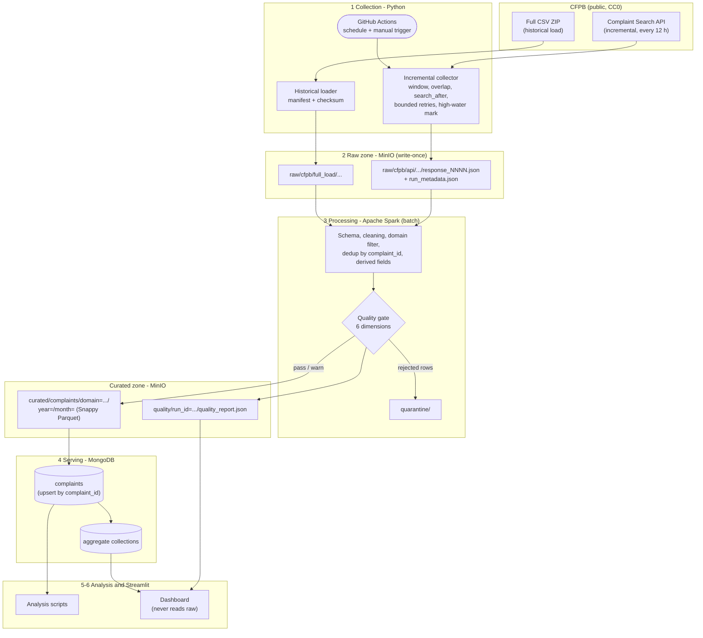

# Architecture

Status: v0.1 (Turn 1). Owner: Mhamad. Reviewed by: Maroun, Ali.

## Data flow

The historical and incremental paths converge on **one curated schema** (`docs/data_dictionary.md`).
The dashboard reads only MongoDB, never the raw zone.

## Components and trade-offs

| Layer | Choice | Why | Trade-off accepted |
|---|---|---|---|
| Collection | Python collector | Full control of windows, `search_after` pagination, retries and run metadata; testable with a mock API; brief allows it | No visual flow or built-in provenance as in Apache NiFi; we reproduce provenance with run metadata and manifests |
| Scheduling | GitHub Actions cron (every 12 h) + manual trigger | Team has no always-on machine; runs are visible to the lecturer; probe proved runners reach the API | Scheduled runs can be delayed or dropped under GitHub load; the wide lookback window makes a missed run lose no data |
| Raw storage | MinIO (S3-compatible object store) | Object-store equivalent of HDFS for a laptop; keeps source files unchanged | Single node: no replication or rack awareness as in HDFS |
| Processing | Apache Spark, batch, local mode | Required engine; DataFrames with explicit schema; handles the multi-GB CSV on a laptop | Local mode, not a master-worker cluster; same code would run on a cluster |
| Curated format | Parquet + Snappy, partitioned by year/month | Columnar, splittable, compressed, schema evolution, partition pruning (Session 3.1) | Slower to write than CSV; small-file risk, managed by repartitioning before write |
| Serving | MongoDB | Dashboard access patterns are filter + group-by on few fields; document per complaint plus pre-aggregated collections | Denormalised aggregates must be rebuilt on each load |
| Visualisation | Streamlit | Required; Python end to end | Limited layout control |
| Operations | Docker Compose + GitHub | One-command start, CI on every PR | Images are large on slow networks |

Not used, by design: Kafka, Flume, Spark Streaming (no real-time requirement); Sqoop (no relational source);
Redis cache (no measured latency problem; listed as future work).

## Decision log

| ID | Date | Decision | Reason | Evidence |
|---|---|---|---|---|
| D-001 | 2026-11-11 | Python collector, not NiFi | 2-week timeline; testability; brief permits both | Brief section 5 |
| D-002 | 2026-11-12 | GitHub Actions as scheduler | No always-on machine; API reachable from runners | PR "CFPB API reachability probe": HTTP 200, 1 attempt |
| D-003 | 2026-11-12 | MinIO image `cgr.dev/chainguard/minio`, pinned by digest | Official MinIO images no longer published; `quay.io/minio/minio` returned 401 | Local `docker pull` output, 2026-11-12 |
| D-004 | 2026-11-12 | Incremental pagination with `search_after` keys, not `frm` offsets | API returns `_meta.break_points`; `frm` offsets reported to repeat page 1 | Probe output; to verify in Turn 2 |
| D-005 | 2026-11-12 | Server-side product filter on every API request | About 680k complaints per 30 days across all products | Probe `total_hits_in_window` |
| D-006 | 2026-11-12 | Public repository | Lecturer must see each member's contributions | Lecturer request |
