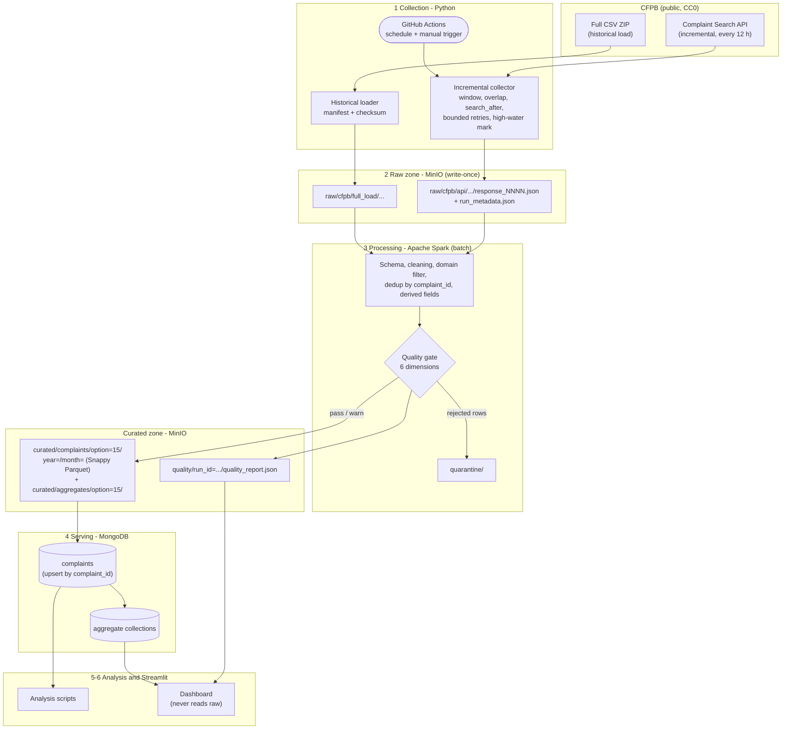

# Architecture

Status: v0.1 (Turn 1). Owner: Mhamad. Reviewed by: Maroun, Ali.

## Data flow

The historical and incremental paths converge on **one curated schema** (`docs/data_dictionary.md`).
The dashboard reads only MongoDB, never the raw zone.

## Components and trade-offs

| Layer | Choice | Why | Trade-off accepted |
|---|---|---|---|
| Collection | Python collector | Full control of windows, `search_after` pagination, retries and run metadata; testable with a mock API; brief allows it | No visual flow or built-in provenance as in Apache NiFi; we reproduce provenance with run metadata and manifests |
| Scheduling | GitHub Actions cron (every 12 h) + manual trigger | Team has no always-on machine; runs are visible to the lecturer; probe proved runners reach the API | Scheduled runs can be delayed or dropped under GitHub load; the wide lookback window makes a missed run lose no data |
| Raw storage | MinIO (S3-compatible object store) | Object-store equivalent of HDFS for a laptop; keeps source files unchanged | Single node: no replication or rack awareness as in HDFS |
| Processing | Apache Spark, batch, local mode | Required engine; DataFrames with explicit schema; handles the multi-GB CSV on a laptop | Local mode, not a master-worker cluster; same code would run on a cluster |
| Curated format | Parquet + Snappy, partitioned by year/month | Columnar, splittable, compressed, schema evolution, partition pruning (Session 3.1) | Slower to write than CSV; small-file risk, managed by repartitioning before write |
| Serving | MongoDB | Dashboard access patterns are filter + group-by on few fields; document per complaint plus pre-aggregated collections | Denormalised aggregates must be rebuilt on each load |
| Visualisation | Streamlit | Required; Python end to end | Limited layout control |
| Operations | Docker Compose + GitHub | One-command start, CI on every PR | Images are large on slow networks |

Not used, by design: Kafka, Flume, Spark Streaming (no real-time requirement); Sqoop (no relational source);
Redis cache (no measured latency problem; listed as future work).

## Decision log

| ID | Date | Decision | Reason | Evidence |
|---|---|---|---|---|
| D-001 | 2026-11-11 | Python collector, not NiFi | 2-week timeline; testability; brief permits both | Brief section 5 |
| D-002 | 2026-11-12 | GitHub Actions as scheduler | No always-on machine; API reachable from runners | PR "CFPB API reachability probe": HTTP 200, 1 attempt |
| D-003 | 2026-11-12 | MinIO image `cgr.dev/chainguard/minio`, pinned by digest | Official MinIO images no longer published; `quay.io/minio/minio` returned 401 | Local `docker pull` output, 2026-11-12 |
| D-004 | 2026-11-12 | Incremental pagination with `search_after` keys, not `frm` offsets | API returns `_meta.break_points`; `frm` offsets reported to repeat page 1 | Probe output; to verify in Turn 2 |
| D-005 | 2026-11-12 | Server-side product filter on every API request | About 680k complaints per 30 days across all products | Probe `total_hits_in_window` |
| D-006 | 2026-11-12 | Public repository | Lecturer must see each member's contributions | Lecturer request |
| D-007 | 2026-11-14 | Send `date_received_max = window end + 1 day` (configurable `date_max_exclusive`) | OpenAPI spec: max is exclusive; +1 day is safe if the spec is wrong (extra day is empty) | cfpb/ccdb5-api `swagger-config.yaml`; live confirmation pending |
| D-008 | 2026-11-14 | Page size 100, not 1000 | Spec limits `size` to 100 (the example metadata showed 1000) | OpenAPI spec |
| D-009 | 2026-11-14 | Compare unique records fetched with API `hits.total`; mismatch makes the run `partial` | Guards against skipped records if `search_after` cursors misbehave (D-004) | `tests/unit/test_incremental.py` |
| D-010 | 2026-11-14 | Scheduled runner is stateless; `sync_artifacts` moves the MinIO high-water mark | Runner cannot reach MinIO; wide lookback makes each run self-sufficient | `.github/workflows/incremental-collection.yml` |
| D-011 | 2026-11-14 | Skip a historical reload when ETag (or Last-Modified + size) is unchanged; never overwrite stored objects | Avoids re-downloading a multi-GB file; contract says raw is write-once | `tests/unit/test_historical.py` |
| D-012 | 2026-11-22 | Option 15 scope = 5 product labels (old + new), split into `deposit_accounts` / `transfers_payments`; `Other financial service` excluded | Label timeline shows the April 2017 renaming; the focus question compares the two segments | `--list-labels` on run `full_20261122T132122Z_9c8cbf` |
| D-013 | 2026-11-22 | Dedup: newest `ingested_at`, then `api` over `full_load`, then highest `record_hash` | Newest publication wins; deterministic on ties | `tests/unit/test_processing_spark.py` |
| D-014 | 2026-11-22 | Read CSV columns by name with an all-string explicit schema built from the manifest header; type in a second step | Real file has 15 columns, older files 17; invalid values must be reported, not silently nulled | real run: 0 malformed rows, Spark count = manifest count |
| D-015 | 2026-11-22 | Never cache the 19M raw rows: one aggregate pass for raw counts, then cache only in-scope rows | Fits a 16 GB laptop with little free disk; full run takes about 3 minutes | run `spark_20261122T170908Z_8b65fe` |
| D-016 | 2026-11-22 | Quality thresholds pre-registered in `config/quality_rules.yaml`, tagged `dq-thresholds-v1` before the first real run; FAIL blocks curated writes | Brief 6.3: results must not move the bar | tag `dq-thresholds-v1` (commit dfc508e) |
| D-017 | 2026-11-22 | Records with a negative routing lag or invalid state are kept and flagged (`quality_flags`), not rejected | They are real complaints; only the interval or the code is wrong | 480 negative lags (all 1 day, 2013), 75 invalid states |
| D-018 | 2026-11-22 | Curated path `option=<n>` instead of `domain=<slug>` | Brief V2 names curated outputs by option number | `docs/data_contracts.md` section 7 |
| D-019 | 2026-11-23 | MongoDB loaded with pymongo bulk upserts from Spark `toLocalIterator`, not the MongoDB Spark connector | No image rebuild (slow network), exact insert/update/unchanged counts via `record_hash` | `database/load.py` |
| D-020 | 2026-11-23 | Flat, fully embedded complaint documents; BSON `Date` for dates | Session 4.1 embed-vs-reference check; range filters on dates | `docs/mongodb.md` sections 2-3 |
| D-021 | 2026-11-23 | Compound indexes `segment + category + date_received` (Equality-Sort-Range) | Mirror the dashboard filters | `docs/evidence/index_benchmark.md` |
| D-022 | 2026-11-23 | Loader refuses a failed quality gate and prunes ids no longer curated only after a full, matching read | Serving layer must equal curated; never delete on a partial read | `database/documents.py`, reconciliation reports |
| D-023 | 2026-11-23 | Aggregates replaced by temp collection + rename | Dashboard never reads a half-written aggregate | `database/load.py` `replace_aggregate` |
